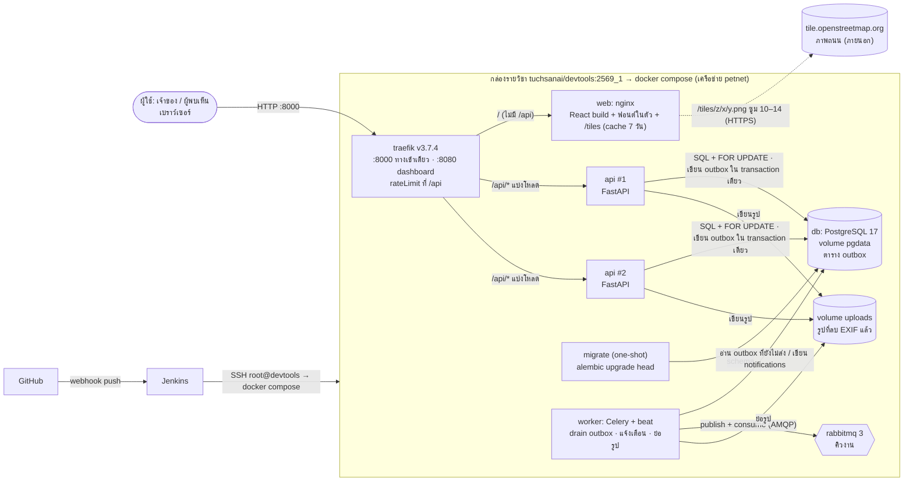

# สถาปัตยกรรมของ La peace (ตรงกับ `infra/docker-compose.yml` ที่รันจริง)

ทุก container อยู่ในเครือข่าย Docker `petnet` เดียวกัน · ออกนอกกล่องรายวิชาแค่พอร์ต `8000` (ระบบ) และ `8080` (Traefik dashboard)
ไม่ใช้ LLM/AI ในระบบ (D4)

## เส้นเชื่อมแต่ละเส้น: ส่งอะไร และเกิดอะไรเมื่อปลายทางล่ม

| จาก → ไป | ส่งอะไร / Protocol | เมื่อปลายทางล่ม |
|---|---|---|
| เบราว์เซอร์ → traefik | HTTP, cookie `httpOnly` (JWT; ติด `Secure` เมื่อ `COOKIE_SECURE=true`) origin เดียว จึงไม่มี CORS · ฟอนต์มาจาก build ของเราเอง ภายนอกที่เบราว์เซอร์ใช้มีแค่ tile ผ่าน nginx | ทั้งระบบเข้าไม่ได้ — compose ไม่มี restart ให้ traefik อัตโนมัติ |
| traefik → api ×2 | HTTP แบ่งโหลดแบบ round-robin · rateLimit average 60 burst 120 | api ตัวหนึ่งล่ม: healthcheck ไม่ผ่าน traefik เลิกส่งไปตัวนั้น อีกตัวรับต่อ · เกิน rate = 429 · body เกิน 6 MB = 413 (Traefik ตอบเป็นข้อความล้วน หน้าเว็บแปลงเป็นข้อความไทย: "ส่งคำขอถี่เกินไป กรุณารอสักครู่แล้วลองใหม่" / "ไฟล์รูปต้องมีขนาดไม่เกิน 5 MB" ใต้ช่องรูป) |
| traefik → web | HTTP ไฟล์ static (SPA fallback ไป `index.html` · ไฟล์ใต้ `/assets/` ที่ไม่มีจริงได้ 404) | หน้าเว็บโหลดไม่ได้ แต่ API ยังตอบ |
| web (nginx) → tile.openstreetmap.org | HTTPS ขอภาพ tile ซูม 10–14 ด้วย User-Agent ของโปรเจกต์ · ไม่ส่ง cookie/IP ผู้ใช้ | ไม่มีเน็ต/OSM ล่ม: ใช้ cache เก่า (`proxy_cache_use_stale`) ถ้าไม่มี cache ภาพถนนว่าง แต่ขอบเขตเขต ตัวเลข และวงกลมบริเวณยังแสดง และหน้าเว็บบอกผู้ใช้ใต้แผนที่ |
| api → db | SQL (SQLAlchemy) · `SELECT … FOR UPDATE` + unique constraint บังคับ C1/C4 | api ตอบ 500 `INTERNAL` พร้อมข้อความไทย (ไม่หลุดรายละเอียดภายใน) · `/api/ready` ตอบ 503 `"db": false` · healthcheck (`/api/health`) ยังผ่านโดยตั้งใจ เพราะเช็คแค่ว่า process ยังอยู่ — ถ้า traefik ถอด api ทั้งสองตัว `/api/*` จะตกไปที่ web แทน |
| api → outbox (ใน db) | แถว `{topic, payload}` เขียนใน transaction เดียวกับข้อมูลธุรกิจ — api **ไม่** ต่อ broker เลย | broker ล่มไม่กระทบการสร้างประกาศ/ส่งเบาะแส (C5) |
| worker → rabbitmq → worker | beat สั่ง `drain_outbox` ทุก 5 วินาที → publish งาน → consume แล้วสร้างแจ้งเตือน (เบาะแสใหม่ → เจ้าของ · สถานะเปลี่ยน → ทุกคนที่เคยส่งเบาะแส) และย่อรูป (ack หลังทำเสร็จ) | แถวค้างใน outbox (`published_at` ว่าง) แล้วส่งเองเมื่อ broker กลับมา — พิสูจน์ด้วย `./scripts/degraded.sh` |
| migrate → db | `alembic upgrade head` ครั้งเดียวก่อน api/worker เริ่ม | migrate ล้ม = api/worker ไม่เริ่ม (`service_completed_successfully`) |
| GitHub → Jenkins → กล่องรายวิชา | webhook push → SSH → build / test / web test / push image / deploy / verify (health + commit, smoke, race) | stage ใดแดง หยุดทันที ไม่ deploy |

ข้อมูลที่คงอยู่: volume `pgdata` (ฐานข้อมูล) และ `uploads` (รูป) อยู่นอก image · config/secret มาจาก `.env` (ไม่ถูก commit; Jenkins สร้างจาก `.env.example` และสุ่ม `JWT_SECRET` ใหม่ทุก build)
